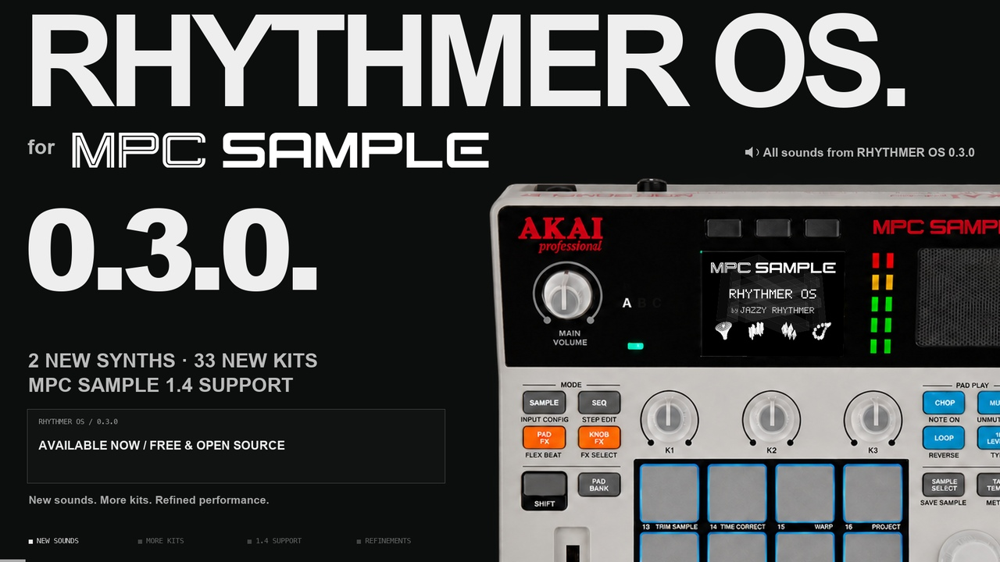
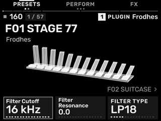
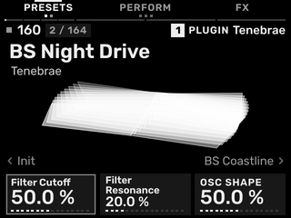
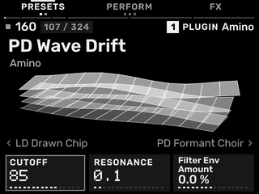
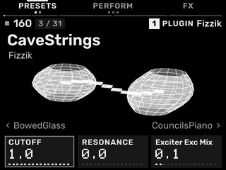
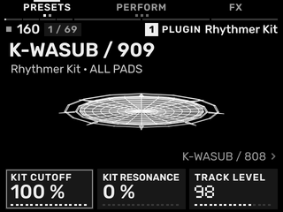

# MPC Sample engine ports

Unofficial native engine adaptations for **Rhythmer OS**, maintained by **jazzy rhythmer**. Original engine names, authors, DSP sources and licenses are retained.

[Download Rhythmer OS](https://github.com/jazzyrhythmer/mpc-sample-rhythmer-os/releases) · [Website](https://jazzyrhythmer.github.io/mpc-sample/) · [Instagram](https://www.instagram.com/jazzyrhythmer/) · [YouTube](https://www.youtube.com/@jazzyrhythmer)

This repository contains port adapters, parameter contracts, pinned original FM-1/Move sources, build helpers and credits. The OS repository contains the sampler, single-sound and Rhythmer Kit host, UI, GEN, Acid and Break workflows, installation and recovery instructions. Melodee by Kerem Kiliç (Ellic Studio) supplies the OS foundation; Open MPC supplies the existing wrapper foundation. These are unofficial ports, not endorsements by the original authors.

<!-- RHYTHMER FILM START -->
## Explore the engines

The earlier film covers 20 engines. [Browse the current 24-engine collection and audio previews](https://jazzyrhythmer.github.io/mpc-sample/#engines), including Frodhes and Tenebrae.

[Watch on the website](https://jazzyrhythmer.github.io/mpc-sample/#engine-ports-film) · [Download 16:9 MP4](https://github.com/jazzyrhythmer/mpc-sample-engine-ports/releases/download/v0.4.0-beta.3-r1/RHYTHMER-20-Engine-Previews-YouTube-Kit-v6-Continuous-Opening.mp4) · [Instagram / Reels 9:16 MP4](https://github.com/jazzyrhythmer/mpc-sample-engine-ports/releases/download/v0.4.0-beta.3-r1/RHYTHMER-20-Engine-Previews-Reels-Kit-v6-Continuous-Opening.mp4)
<!-- RHYTHMER FILM END -->

## RHYTHMER OS 0.3.0

**24 engine entries · 69 complete kits · MPC Sample 1.4 support.**

Amino adds wavetable synthesis with 324 original presets. Fizzik adds physical-modeling synthesis with 31 original presets. There are 33 new kits: 32 from Weird Dreams’ original banks and one 16-voice KrautDrums kit.

Break PERF held effects, A/B switching and Return are refined, alongside parameter groups, track switching, GEN/Acid/Break navigation and save/recovery fixes. Supports stock firmware **1.3.0.12, 1.4.0.7 and 1.4.0.8**; an official firmware update is not required.

Use the **full SD package** so the application, plug-ins and catalogue match. On stock 1.4, enable Developer Mode before a direct installation. If using a boot manager, preserve its launcher and follow its version-specific instructions.

[Download & installation](https://jazzyrhythmer.github.io/mpc-sample/installer/) · [Current manual](https://jazzyrhythmer.github.io/mpc-sample/manual/) · [Release files](https://github.com/JazzyRhythmer/mpc-sample-rhythmer-os/releases/tag/v0.3.0)

Early beta. Software checks have passed; physical-device installation of this release has not been verified.

## Available instruments

The matching RHYTHMER OS **0.3.0** catalogue exposes **24 instrument entries**, **69 Rhythmer Kits** and **3,812 sound selections across 31 source views**, including kit voices and shared Acid choices. These ports currently depend on the RHYTHMER host integration; use the OS full SD package rather than treating this repository as a generic plug-in installer.

### Frodhes

57 original electric-piano, vibraphone and marimba programs.

### Tenebrae

Eight oscillator models and 164 original programs including Init.

### Amino

Wavetable synthesis with 324 original presets. Explore layered pads, moving textures, basses and leads.

### Fizzik

Physical-modeling synthesis with 31 original presets. Shape the exciter, two resonators, envelopes, modulation and effects.

## Ports and original sources

| Port directory | Original project | Source record |
|---|---|---|
| [drumx](ports/drumx) | [https://github.com/juanjiant-bit/JIANT](https://github.com/juanjiant-bit/JIANT) | [pinned provenance](ports/drumx/SOURCE.json) |
| [fm1-cs1](ports/fm1-cs1) | [https://github.com/twochannels/CS-1.git](https://github.com/twochannels/CS-1.git) | [pinned provenance](ports/fm1-cs1/SOURCE.json) |
| [fm1-elixir](ports/fm1-elixir) | [https://github.com/dmajka/elixir.git](https://github.com/dmajka/elixir.git) | [pinned provenance](ports/fm1-elixir/SOURCE.json) |
| [fm1-fm106](ports/fm1-fm106) | [https://github.com/PatttF/fm-106.git](https://github.com/PatttF/fm-106.git) | [pinned provenance](ports/fm1-fm106/SOURCE.json) |
| [fm1-fmini](ports/fm1-fmini) | [https://github.com/ruppert/fmini-1.git](https://github.com/ruppert/fmini-1.git) | [pinned provenance](ports/fm1-fmini/SOURCE.json) |
| [fm1-guru600](ports/fm1-guru600) | [https://github.com/MarcGoudy/guru-600.git](https://github.com/MarcGoudy/guru-600.git) | [pinned provenance](ports/fm1-guru600/SOURCE.json) |
| [fm1-hortator](ports/fm1-hortator) | [https://github.com/deadactive/hortator.git](https://github.com/deadactive/hortator.git) | [pinned provenance](ports/fm1-hortator/SOURCE.json) |
| [fm1-kwasub](ports/fm1-kwasub) | [https://github.com/Guizmoh/K-WASUB_Firmware_for_FM1.git](https://github.com/Guizmoh/K-WASUB_Firmware_for_FM1.git) | [pinned provenance](ports/fm1-kwasub/SOURCE.json) |
| [fm1-kwasub-kit](ports/fm1-kwasub-kit) | [https://github.com/Guizmoh/K-WASUB_Firmware_for_FM1.git](https://github.com/Guizmoh/K-WASUB_Firmware_for_FM1.git) | [pinned provenance](ports/fm1-kwasub-kit/SOURCE.json) |
| [fm1-mono2k](ports/fm1-mono2k) | [https://github.com/InigoHernandez/mono2k.git](https://github.com/InigoHernandez/mono2k.git) | [pinned provenance](ports/fm1-mono2k/SOURCE.json) |
| [fm1-obervave](ports/fm1-obervave) | [https://github.com/zvenson/obervave.git](https://github.com/zvenson/obervave.git) | [pinned provenance](ports/fm1-obervave/SOURCE.json) |
| [fm1-prophet](ports/fm1-prophet) | [https://github.com/keremimo/melodee.git](https://github.com/keremimo/melodee.git) | [pinned provenance](ports/fm1-prophet/SOURCE.json) |
| [fm1-s1vave](ports/fm1-s1vave) | [https://github.com/AndrewGG88/S1Vave.git](https://github.com/AndrewGG88/S1Vave.git) | [pinned provenance](ports/fm1-s1vave/SOURCE.json) |
| [move-aphex](ports/move-aphex) | [filliformes/aphex-move](https://github.com/filliformes/aphex-move) | [pinned provenance](ports/move-aphex/SOURCE.json) |
| [move-braids](ports/move-braids) | [charlesvestal/schwung-braids](https://github.com/charlesvestal/schwung-braids) | [pinned provenance](ports/move-braids/SOURCE.json) |
| [move-dexed](ports/move-dexed) | [charlesvestal/schwung-dx7](https://github.com/charlesvestal/schwung-dx7) | [pinned provenance](ports/move-dexed/SOURCE.json) |
| [move-hera](ports/move-hera) | [charlesvestal/schwung-hera](https://github.com/charlesvestal/schwung-hera) | [pinned provenance](ports/move-hera/SOURCE.json) |
| [move-plaits](ports/move-plaits) | [j3threejay/move-anything-plaits](https://github.com/j3threejay/move-anything-plaits) | [pinned provenance](ports/move-plaits/SOURCE.json) |
| [fm1-frodhes](ports/fm1-frodhes) | [Frodhes](https://github.com/leonardoMirabal/frodhes.git) | [pinned provenance](ports/fm1-frodhes/SOURCE.json) |
| [move-tenebrae](ports/move-tenebrae) | [Tenebrae](https://github.com/legsmechanical/schwung-tenebrae) | [pinned provenance](ports/move-tenebrae/SOURCE.json) |

Sophie is included under `ports/sophie`, with the original DSP and notices. The seven classic drum variants remain kit-only in the OS. Elixir is the canonical LXR-family adaptation. Acid uses Hortator ACID and Aphex; Break and Rhythmer Kit are host features, not separate original synth ports. Original baseline MPC drum packages retain their names and source records in `third_party/mpc-original`.

## Build

See [BUILD.md](BUILD.md) for Linux ARM64 build examples and the distinction between wrappers and native Move DSP modules. The complete engine source is included, with transitive notices under each original tree. The matching OS release provides SOURCE, MOVE-SOURCE and SUPPORT-SOURCE archives for corresponding source and support-library rebuilds.

## Banks and sound design

Original available banks are preserved except the external Sequential Prophet and Erica/Hrtl Elixir banks, whose redistribution permission was not established for this port. They are excluded from both source and binary releases. Native Prophet retains Init; native Elixir retains Initkit. Rhythmer's host-side catalogue adds 15 independently authored Prophet sounds and four seven-voice Elixir kits. These extra choices require the Rhythmer host integration; they are not claimed to be original factory programs or built into a generic standalone wrapper. The four authored Elixir kicks include the approved stronger body/attack.

[Preset provenance and names](docs/RHYTHMER_PRESETS.md) · [Bank audit](docs/ORIGINAL_PRESET_AUDIT_KO.md) · [Source lineage](docs/FM1_LINEAGE_KO.md) · [Credits](THIRD_PARTY_NOTICES.md) · [Validation and limits](docs/VERIFICATION.md)

Licenses apply per component; the root license does not relicense original sources, patches, fonts or third-party assets. This is unofficial software, unaffiliated with AKAI Professional or inMusic, provided without warranty under its applicable licenses.  Use the OS full SD download for installation; this source repository is not an installer.

## Rhythmer Kit

Hit-responsive drum geometry, with a restrained input-driven depth response.

<!-- JAZZY-RHYTHMER-PORTFOLIO:START -->
## More from Jazzy Rhythmer

**For MPC Sample:** [RHYTHMER OS](https://jazzyrhythmer.github.io/mpc-sample/) · **For FM-1:** [JAZZY](https://jazzyrhythmer.github.io/jazzy/) / [RHYTHMER](https://jazzyrhythmer.github.io/rhythmer/)

**JR Audio Software** — in development, expected in 2027: [JR ACID](https://jazzyrhythmer.github.io/software.html#jr-acid) · [JR FX](https://jazzyrhythmer.github.io/software.html#jr-fx) · [JR SMPL](https://jazzyrhythmer.github.io/software.html#jr-smpl) · [JR RYTM](https://jazzyrhythmer.github.io/software.html#jr-rytm) · [JR DRAW](https://jazzyrhythmer.github.io/software.html#jr-draw) · [JR PLAY](https://jazzyrhythmer.github.io/software.html#jr-play) · [JR TREK](https://jazzyrhythmer.github.io/software.html#jr-trek).

[Main website](https://jazzyrhythmer.github.io/) · [Ko-fi](https://ko-fi.com/jazzyrhythmer) · [Patreon](https://www.patreon.com/JazzyRhythmer/) · [Studio Notes & email updates](https://jazzyrhythmer.github.io/#notes) · [YouTube](https://www.youtube.com/@jazzyrhythmer) · [Instagram](https://www.instagram.com/jazzyrhythmer/)

Voluntary support helps me keep making music, instruments and open-source tools. Thank you for being part of it.
<!-- JAZZY-RHYTHMER-PORTFOLIO:END -->

## Matching release source

The `runtime/` tree in the OS repository contains the matching application source. `release-ports/` contains the source snapshots supplied with this release’s engine libraries, including their original notices. Refer to each project’s licence before reuse. The compiled plug-ins are in the full SD release package. No break recordings are bundled.

Built on **Melodee by Kerem Kiliç (Ellic Studio)**. Thanks to the original engine authors and open-source communities.

New sources: [Amino](https://github.com/klaine/amino) · [Fizzik](https://github.com/filliformes/fizzik-move) · [Weird Dreams](https://github.com/filliformes/weird-dreams-move) · [KrautDrums](https://github.com/filliformes/krautdrums-move). Their pinned references and notices are retained in `release-ports/`.
